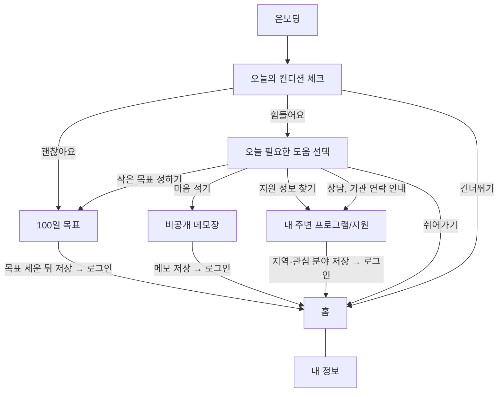

# 유저플로우 & IA

> 원본: Figma `[2026 간지톤] 2팀` → `서비스 구조` 페이지 (User Flow, IA 프레임)
> 화면 번호(0-1, 1-1 …)는 Figma 와이어프레임 프레임 이름과 같습니다.

## 1. IA (메뉴 · 화면 구조)

```text
서비스
 ┣ 0 시작                         (팀원B)
 ┃  ┣ 0-0 스플래시
 ┃  ┣ 0-1 온보딩
 ┃  ┣ 0-2 컨디션
 ┃  ┣ 0-3 필요한 도움
 ┃  ┣ 0-4 로그인/회원가입
 ┃  ┗ 0-5 초기 설정
 ┣ 1 홈                           (팀원A)
 ┃  ┗ 1-1 홈 대시보드 / 1-2 목표 기록 후 홈 대시보드 (괜찮아요·힘들어요)
 ┣ 2 100일 목표                    (팀원A)
 ┃  ┣ 2-1 목표 설정 (내가 바라는 변화 입력)
 ┃  ┣ 2-2 목표 설정 확인 (AI 주간 계획 초안) / 목표 대시보드
 ┃  ┗ 목표 기록 후 상태
 ┣ 3 비공개 메모장                  (팀원A)
 ┃  ┗ 3-1 메모 목록 (+ 작성·상세·수정·삭제 팝업)
 ┣ 4 내 주변 프로그램/지원 서비스     (팀원B)
 ┃  ┣ 4-1 프로그램·지원 목록 / 상담·기관 목록
 ┃  ┗ 상세
 ┗ 5 내 정보                       (팀원B)
    ┣ 5-1 내 정보
    ┣ 프로필 수정
    ┗ 개인정보 처리 안내
```

하단 내비게이션 탭: **홈 · 목표 · 메모 · 지원 · 내 정보**
(Figma 변형 중 일부는 `목표` 탭 없이 4개 탭으로 그려져 있음 → 확정 필요)

## 2. 전체 유저플로우



### 로그인 시점

- 비회원으로 둘러볼 수 있다.
- **저장하는 순간** 로그인으로 보낸다: 목표 저장, 메모 저장, 지역·관심 분야 저장.
- 로그인: 카카오톡 / 네이버 간편 로그인. 자동 로그인 체크 시 로그인 과정 생략.
- 로그인 직후 초기 설정: 닉네임(필수), 관심 분야·생년월일·지역(선택).

## 3. 100일 목표 진입 분기

| 방문 | 컨디션 | 기존 목표 | 이동 |
|---|---|---|---|
| 첫방문/재방문 | 괜찮아요 | 없음 | 목표 설정 → 대시보드 → 목표 기록 후 상태 |
| 재방문 | 괜찮아요 | 있음 | 대시보드 → 목표 기록 후 상태 |
| 첫방문/재방문 | 힘들어요 | 없음 | 목표 설정 → 대시보드 → 목표 기록 후 상태 |
| 재방문 | 힘들어요 | 있음 | 대시보드 → 목표 기록 후 상태 |
| 첫방문/재방문 | 건너뛰기 | 없음/있음 | 메뉴로 직접 진입 (아래 표) |

`힘들어요`를 선택하면 AI가 오늘의 목표를 **더 작은 목표**로 세워 준다.

### 컨디션에 따른 오늘의 목표 (목표 캘린더 표)

| 들어온 경로 | 처음 보여줄 내용 | 사용자가 바꿀 수 있는 것 |
|---|---|---|
| 괜찮아요 | 기존 계획 또는 기본 크기의 목표 | 그대로 선택 / 줄이기 / 더 도전하기 |
| 힘들어요 → 작은 목표 정하기 | 기존 계획을 더 작게 나눈 목표 | 선택 / 다른 목표 / 원래 계획 / 쉬기 |
| 컨디션 건너뛰기·메뉴로 직접 진입 | 기존 계획 표시, 새 목표는 크기를 직접 선택 | 작게 / 기본 / 직접 입력 |

### 오늘 목표 상태별 처리

| 목표 상태 | 처리 |
|---|---|
| 기존 목표 없음 | 관심 있는 활동 선택 → 크기에 맞는 목표 제안 |
| 기존 목표 있음 | 오늘 계획을 유지하거나 작게 조정해서 제안 |
| 오늘 목표 이미 확정 | 확정된 목표 표시 → 원하면 조정 |
| 오늘 목표 이미 완료 | 완료 상태 표시 → 추가 목표는 사용자가 원할 때만 |

## 4. 지원 정보 (팀원B 참고)

| 로그인 상태 | 적용 지역 | 화면 |
|---|---|---|
| 비회원 | 없음 | 전국 대상 정보 + `지역 선택` |
| 비회원 | 이번 방문에서 선택함 | 선택한 지역 정보 + 지역 변경 |
| 회원 | 등록하지 않음 | 전국 대상 정보 + `지역 선택` |
| 회원 | 등록됨 | 등록 지역 기본 적용 + 지역 변경 |

| 진입 버튼 | 처음 열리는 탭 | 우선 보여줄 정보 |
|---|---|---|
| 지원 정보 찾기 | 프로그램·지원 | 대상, 신청 기간, 장소, 비용, 신청 방법 |
| 상담·기관 연락 안내 | 상담·기관 | 상담 내용, 이용 대상, 운영 시간, 연락 방법 |
